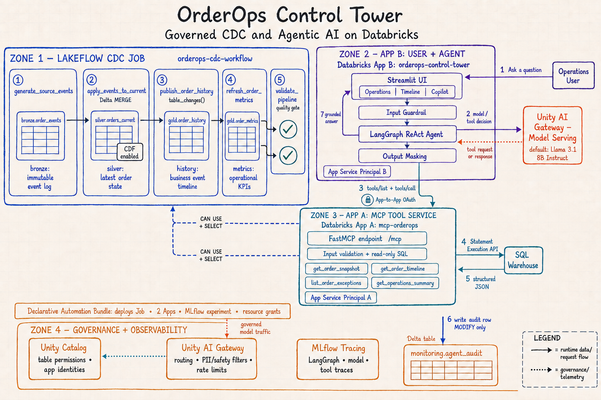
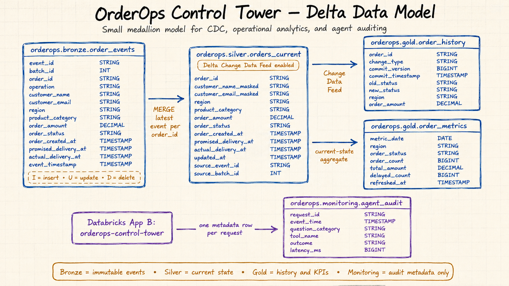

# OrderOps Control Tower: A Governed CDC and Agentic AI Platform on Databricks

**Production-style order operations with Delta Lake CDC, a Lakeflow Job, governed MCP tools, LangGraph, Unity AI Gateway, Databricks Apps, and MLflow.**

OrderOps Control Tower maintains the current state and change history of e-commerce orders. A five-task Lakeflow Job runs the CDC flow end to end. A read-only MCP App exposes four governed business tools, while a separate Streamlit and LangGraph App uses those tools to answer operational questions.



## Problem statement

Order operations teams need to know what an order looks like now, how it reached that state, and where exceptions are developing. Source systems continually insert, update, and delete records. Full reloads are inefficient, manual notebook execution is unreliable, and direct agent access to operational tables creates an unnecessarily large security surface.

The project addresses those concerns with:

- an append-only synthetic CDC event source;
- Delta `MERGE` for the latest current state;
- Delta Change Data Feed for durable business history;
- a parameterized, serverless Lakeflow Job with dependency ordering and quality gates;
- a Databricks Declarative Automation Bundle for the Job, experiment, and Apps;
- a stateless custom MCP server with four allowlisted, read-only tools;
- a LangGraph ReAct agent deployed inside a Databricks App;
- deterministic input/output guardrails plus optional Unity AI Gateway policies; and
- MLflow traces and minimal Delta audit metadata.

## Deliberate implementation choice

The CDC flow uses a **Lakeflow Job**, not a Lakeflow Spark Declarative Pipeline. This keeps `MERGE`, Change Data Feed, and the business-history conversion visible in ordinary notebooks. It is easier to inspect and modify while still providing production-style task dependencies, parameters, rerun behavior, failure propagation, and monitoring.

The five tasks run serially, so the workflow stays within Free Edition's five-concurrent-task quota. No classic cluster configuration is included; notebook tasks use serverless compute.

## CDC workflow

```text
generate_source_events
        │
        ▼
apply_events_to_current
        │
        ▼
publish_order_history
        │
        ▼
refresh_order_metrics
        │
        ▼
validate_pipeline
```

| Task | Notebook | Responsibility |
|---|---|---|
| `generate_source_events` | `notebooks/data_generation/01_generate_order_events.py` | Creates initial batch 1 or a parameterized CDC batch containing inserts, updates, and deletes |
| `apply_events_to_current` | `notebooks/cdc/01_apply_events_to_current.py` | Selects the latest event per order, masks PII, and applies inserts, updates, and deletes with Delta `MERGE` |
| `publish_order_history` | `notebooks/cdc/02_publish_order_history.py` | Reads only unprocessed silver CDF versions and publishes one business row per order change |
| `refresh_order_metrics` | `notebooks/cdc/03_refresh_order_metrics.py` | Rebuilds the small current-state regional/status aggregate |
| `validate_pipeline` | `notebooks/quality/01_validate_pipeline.py` | Fails the Job for duplicate keys, unmasked email, count mismatches, or empty required outputs |

### Job parameters

| Parameter | Default | Use |
|---|---:|---|
| `catalog_name` | `orderops` | Unity Catalog location for all tables |
| `load_mode` | `initial` | Use `initial` for deterministic batch 1 or `cdc` for a new change batch |
| `initial_order_count` | `200` | Number of initial orders; accepted range is 20–5,000 |
| `cdc_batch_id` | `2` | Unique incremental batch identifier; increase it for every CDC run |
| `cdc_batch_size` | `15` | Incremental event count; accepted range is 3–100 |

The initial run is idempotent because it merges on `event_id`. A CDC batch ID cannot be reused, preventing accidental duplicate batches.

## Data path

1. The generator writes immutable `I`, `U`, and `D` events to `bronze.order_events`.
2. The merge task orders events by `event_timestamp` and `event_id`, then writes the latest non-deleted state to `silver.orders_current`.
3. Change Data Feed records the silver inserts, preimages, postimages, and deletes.
4. The history task reads `table_changes()` from the next unprocessed Delta version and writes `gold.order_history`.
5. The metric task publishes `gold.order_metrics` from the current silver state.
6. The quality task independently reconciles the latest non-delete events, silver count, gold count, key uniqueness, and masking rule.

## Application boundary

| App | What it owns | Granted resources | Explicit boundary |
|---|---|---|---|
| `mcp-orderops-dev` | FastMCP `/mcp`, argument validation, and four fixed SQL tools | SQL warehouse plus `SELECT` on silver current state and two gold tables | No model, no UI, no arbitrary SQL, no write tools |
| `orderops-control-tower-dev` | Streamlit, input/output guardrails, LangGraph ReAct agent, model call, audit write, and MLflow tracing | MCP App, model endpoint, MLflow experiment, SQL warehouse, and `MODIFY` on the audit table | No direct `SELECT` on operational tables |

The Bundle creates a dedicated service principal for each App and binds only the resources declared in `resources/orderops_apps.yml`.

## Agent request path

1. A user submits a question through Streamlit.
2. A Streamlit fragment records the question and queues a background ReAct job, so only the chat region refreshes and the complete App does not fade.
3. `guardrails.py` blocks prompt-bypass, bulk-PII, mutation, off-topic, empty, and oversized requests before model inference.
4. LangGraph calls the configured model endpoint. The Bundle default is `databricks-meta-llama-3-1-8b-instruct`.
5. For allowed OrderOps questions, LangGraph calls the model and lets the ReAct agent select an MCP tool through Databricks app-to-app OAuth.
6. The MCP App validates the arguments, executes fixed read-only SQL through the Statement Execution API, and returns structured JSON.
7. LangGraph composes the answer; output masking removes accidental email or phone content.
8. MLflow exports graph/model/tool spans asynchronously, and a separate worker writes request metadata to `monitoring.agent_audit`; neither operation delays the visible answer.

## Model configuration

The model is intentionally declared in the Bundle rather than hardcoded in Python:

```yaml
llm_endpoint_name:
  default: databricks-meta-llama-3-1-8b-instruct
```

`resources/orderops_apps.yml` assigns that endpoint to the copilot App with `CAN_QUERY`. `apps/copilot_app/app.yaml` resolves the assignment into `DATABRICKS_LLM_ENDPOINT`, and `app.py` passes it to `ChatDatabricks`.

Free Edition exposes a region-dependent subset of Foundation Model APIs. Before deployment, confirm that the default is visible in AI Playground and marked as tools-enabled. If it is unavailable, set `llm_endpoint_name` to another tools-enabled endpoint during Bundle validation and deployment. The setup guide provides the exact override command.

## Guardrail placement

| Layer | Location | Purpose |
|---|---|---|
| Input guardrail | `apps/copilot_app/guardrails.py` | Blocks unsafe or off-topic request shapes before inference |
| Tool schemas | `apps/mcp_server/validation.py` | Restricts order IDs, regions, limits, hours, and table identifiers |
| Tool boundary | `apps/mcp_server/app.py` | Exposes only four read-only business operations |
| Output guardrail | `apps/copilot_app/guardrails.py` | Masks accidental email and phone output |
| Identity and data access | `resources/orderops_apps.yml` | Applies least-privilege App resource permissions |
| Model/MCP service policy | Unity AI Gateway UI, when available | Adds platform PII, prompt-injection, safety, topic, approval, and rate-limit controls |
| Trace evidence | MLflow experiment | Captures LangGraph, model, and tool spans |

Unity Gateway service policies require workspace support and, for beta policies, an account administrator to enable the preview. Free Edition has no account console, so these controls might not be available in every Free Edition workspace. The code-level guardrails and least-privilege MCP boundary always remain active.

## Data model



| Layer | Object | Purpose |
|---|---|---|
| Bronze | `order_events` | Immutable synthetic source events, including raw demonstration PII |
| Silver | `orders_current` | Latest masked state per order with CDF enabled |
| Gold | `order_history` | Durable business history created from CDF |
| Gold | `order_metrics` | Current regional and status-level metrics |
| Monitoring | `agent_audit` | Request ID, category, tools, outcome, and latency only |

## MCP tools

| Tool | Purpose | Restriction |
|---|---|---|
| `get_order_snapshot` | Current state of one order | Validated `ORD-00001` identifier; no PII |
| `get_order_timeline` | CDC-derived history of one order | Maximum 25 changes |
| `list_order_exceptions` | Delayed or overdue current orders | Allowlisted regions; maximum 50 rows |
| `get_operations_summary` | Regional metrics and recent changes | History window capped at seven days |

## Repository map and file responsibilities

```text
orderops-control-tower-databricks/
├── databricks.yml
├── resources/
│   ├── orderops_cdc.job.yml
│   ├── orderops_apps.yml
│   └── README.md
├── notebooks/
│   ├── README.md
│   ├── shared/00_config.py
│   ├── setup/01_create_catalog_and_schemas.py
│   ├── setup/02_create_tables.py
│   ├── data_generation/01_generate_order_events.py
│   ├── cdc/01_apply_events_to_current.py
│   ├── cdc/02_publish_order_history.py
│   ├── cdc/03_refresh_order_metrics.py
│   └── quality/01_validate_pipeline.py
├── apps/
│   ├── mcp_server/
│   └── copilot_app/
├── assets/
├── tests/
├── requirements-dev.txt
└── setup/README.md
```

| File | Why it exists |
|---|---|
| `README.md` | Architecture, workflow, component boundaries, data model, and file-by-file project reference |
| `.gitignore` | Excludes local environments, caches, secrets, and generated Bundle state |
| `databricks.yml` | Bundle entry point, deployment target, warehouse lookup, catalog variable, and default model endpoint |
| `resources/orderops_cdc.job.yml` | Five-task serverless Lakeflow Job and its run-time parameters |
| `resources/orderops_apps.yml` | MLflow experiment, both Apps, service-principal resource assignments, and permissions |
| `resources/README.md` | Short explanation of Bundle resource keys and deployment-time values |
| `notebooks/README.md` | Notebook execution order, inputs, outputs, and interactive-run guidance |
| `notebooks/shared/00_config.py` | Reads Job parameters, supplies interactive defaults, validates values, and constructs table names |
| `notebooks/setup/01_create_catalog_and_schemas.py` | First-time creation of the catalog and bronze/silver/gold/monitoring schemas |
| `notebooks/setup/02_create_tables.py` | First-time creation of all five Delta tables and CDF configuration |
| `notebooks/data_generation/01_generate_order_events.py` | Synthetic initial or CDC event generation; replaceable by a real ingestion source |
| `notebooks/cdc/01_apply_events_to_current.py` | PII masking and idempotent bronze-to-silver `MERGE` |
| `notebooks/cdc/02_publish_order_history.py` | Incremental CDF version processing into durable history |
| `notebooks/cdc/03_refresh_order_metrics.py` | Current-state aggregate refresh for dashboards and MCP |
| `notebooks/quality/01_validate_pipeline.py` | Fail-fast data quality and reconciliation checks |
| `apps/mcp_server/app.py` | FastMCP server and the four SQL-backed domain tools |
| `apps/mcp_server/validation.py` | Pure allowlist and bounds validation used by MCP tools |
| `apps/mcp_server/app.yaml` | MCP App start command and Bundle resource-to-environment mapping |
| `apps/mcp_server/requirements.txt` | MCP App runtime dependencies |
| `apps/copilot_app/app.py` | Streamlit pages, MCP clients, LangGraph agent, audit insert, and tracing setup |
| `apps/copilot_app/guardrails.py` | Deterministic input blocking, question classification, masking, and identifier quoting |
| `apps/copilot_app/app.yaml` | Copilot start command and resource-to-environment mapping, including the LLM endpoint |
| `apps/copilot_app/requirements.txt` | Copilot App runtime dependencies |
| `tests/test_guardrails.py` | Unit tests for blocking, masking, classification, and audit-table quoting |
| `tests/test_mcp_validation.py` | Unit tests for MCP IDs, regions, limits, and table quoting |
| `assets/*.png` | Architecture and physical data-model visuals |
| `assets/IMAGE_PROMPTS.md` | Reproducible visual-generation prompts |
| `requirements-dev.txt` | Local test dependency list |
| `setup/README.md` | Exact first-time bootstrap, deployment, execution, testing, guardrail, and troubleshooting procedure |

## Deployment sequence

The first deployment intentionally has two stages:

1. Run the two setup notebooks once so the App table-resource assignments have real tables to reference.
2. Run `databricks bundle validate` and `databricks bundle deploy` to create the workflow, experiment, Apps, and permissions.

After deployment, use the Bundle to run the workflow and both Apps. No CI/CD platform is required.

Follow the complete [setup, deployment, execution, and testing guide](setup/README.md).

## Current platform references

- [Databricks Free Edition limits](https://docs.databricks.com/aws/en/getting-started/free-edition-limitations)
- [Declarative Automation Bundles](https://docs.databricks.com/aws/en/dev-tools/bundles)
- [Serverless Lakeflow Jobs](https://docs.databricks.com/aws/en/jobs/run-serverless-jobs)
- [Bundle Job parameters](https://docs.databricks.com/aws/en/dev-tools/bundles/job-parameters)
- [Databricks Apps resources](https://docs.databricks.com/aws/en/dev-tools/databricks-apps/resources)
- [Foundation Model API models](https://docs.databricks.com/aws/en/machine-learning/foundation-model-apis/supported-models)
- [Unity Gateway AI governance](https://docs.databricks.com/aws/en/ai-gateway/ai-governance)
- [Custom MCP servers](https://docs.databricks.com/aws/en/agents/mcp-tools/custom-mcp)
- [MLflow LangGraph tracing](https://docs.databricks.com/aws/en/mlflow3/genai/tracing/integrations/langgraph)
